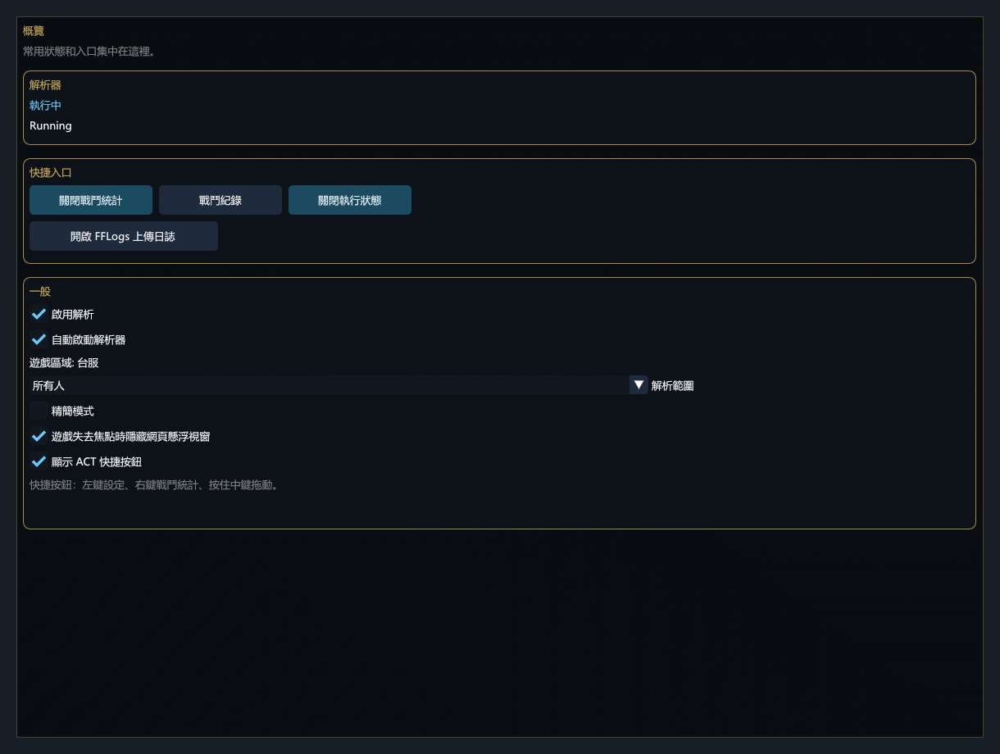
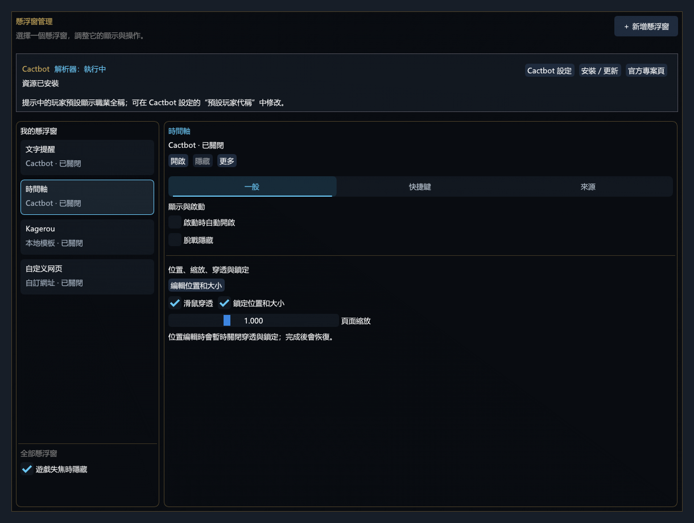
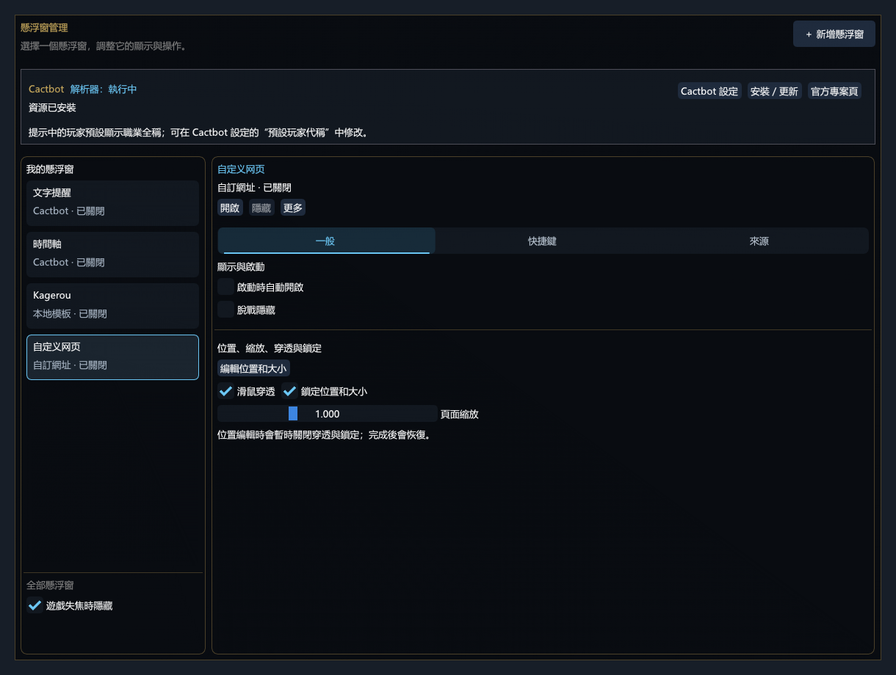
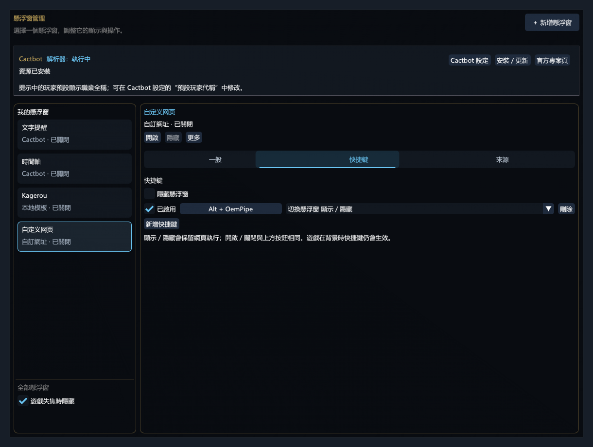
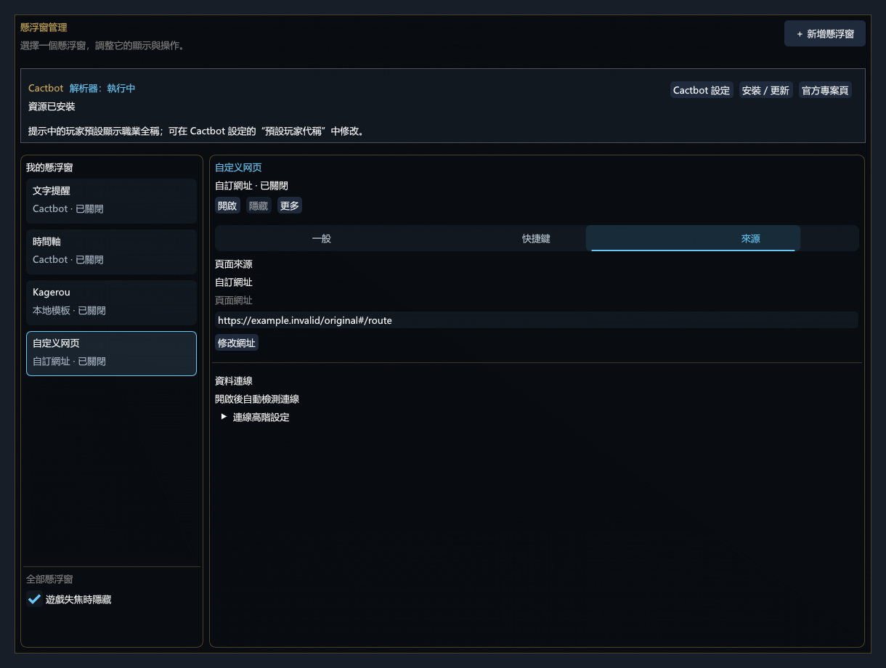

# Dalamud ACT Compat (TW)

> This repository is the independent Taiwan API 13 / .NET 9 candidate. Matcha is excluded. In-game Taiwan acceptance is pending. See [Taiwan build notes](docs/taiwan-build.md) for pinned dependencies and validation limits.

[繁體中文](README.md) | [English](README_EN.md)

[Website (中文)](https://dact.localhost2019.com/) · [Taiwan candidate builds](https://github.com/JackyWilliam/DalamudActCompat-TW/actions/workflows/build.yml) · [Third-party compatibility](docs/third-party-compatibility.md) · [Report an issue](https://github.com/JackyWilliam/DalamudActCompat-TW/issues) · [Support on Afdian](https://ifdian.net/a/raynor)

**Use an in-game combat meter, Cactbot overlays, and common ACT extensions directly in FFXIV through Dalamud—without running ACT separately.**

Dalamud ACT Compat (DACT) combines `FFXIV_ACT_Plugin`, `OverlayPlugin`, and an in-game UI in one Dalamud plugin. Traditional ACT extensions such as Triggernometry, PostNamazu, and FoxTTS run in separate Host processes. If an extension hangs, you can restart its Host instead of immediately restarting the game.

> **DACT is a free project.** Neither the plugin nor its one-time activation keys are sold. Do not buy or resell them; report anyone charging for DACT or its keys through [Issues](https://github.com/JackyWilliam/DalamudActCompat-TW/issues), the QQ group, or Discord.

This checkout targets **Windows, Taiwan Dalamud API 13 and .NET 9**. It is an unofficial project and has not yet been validated in the Taiwan game client.

## What you can do with it

| Feature | What it is for |
| --- | --- |
| In-game combat meter | View 4/8/24-player DPS, rDPS, HPS, total damage, highest-hit actions, hit rates, deaths, and a local FFLogs percentile estimate |
| Meter styles | Choose one of Classic, Horizontal, or Role Split; customize ordered slots in Page preview while Horizontal remains background-free |
| Encounter history | Store runs and individual pulls, then inspect party data and raw logs |
| Cactbot / HTML overlays | Install Cactbot resources and create, resize, lock, or click through in-game overlays |
| Common ACT extensions | Use Triggernometry, PostNamazu, ACT.FoxTTS, and SilverDasher |
| Imported extensions | Preflight DLL/ZIP packages and load compatible ACT plugins in a generic Host after permission review |
| Accounts and cloud sync | Register with an activation key, optionally sign in automatically, create up to three friend invitations, and back up configuration with end-to-end encryption |
| Friends and chat | Add friends, view presence, exchange messages and receive offline messages, with unread indicators, incoming bubbles, quick replies, and four notification sounds |
| Shared RPets sign-in | Synchronize sign-in, account switching, and sign-out with the separately installed RPets plugin |
| Isolation and diagnostics | Inspect the parser, shared Host and generic Host separately, then stop or restart only the failing component |

DACT does not promise compatibility with every ACT plugin. Extensions that depend on old .NET Framework behavior, injection, arbitrary memory access, specialized ACT UI, or unimplemented APIs may not work.

## Installation

### 1. Add the Taiwan plugin repository

In the Taiwan client, open `/xlsettings` and add this URL under Experimental → Custom Plugin Repositories, then enable it and save:

```text
https://raw.githubusercontent.com/JackyWilliam/DalamudActCompat-TW/main/repo/pluginmaster.json
```

Open `/xlplugins`, refresh, and install **Dalamud ACT Compat (TW)**. The same URL supplies future updates. It currently serves the **0.4.5.15 test candidate**, defaults to Traditional Chinese, and excludes Matcha. Taiwan in-game acceptance is still pending.

The full package is also available from [GitHub Release](https://github.com/JackyWilliam/DalamudActCompat-TW/releases/tag/v0.4.5.15), or build it with `tools/build-taiwan.ps1`. This repository requires the pinned Taiwan API 13 client; do not mix it with the CN repository.

See [Taiwan build notes](docs/taiwan-build.md) before testing. Do not use the historical CN repair utility for this build.

### 2. Obtain a one-time activation key

Registering a DACT account requires a one-time activation key. Join QQ group **1098561701** or the [Discord server](https://discord.gg/mZHFwXe7Gk), then contact the group or server owner to request one.

> An activation key expires after use. Do not post a received key in an Issue or any other public location.

### 3. Complete first-time setup

1. Read the third-party extension notice. Check each author, source, version, permission set, and SHA-256 before deciding whether to install and authorize it.
2. Enter `/actcompat` to open the Control Center.
3. On Overview, keep Enable parsing and Start parser automatically enabled. Confirm the status at the top is Running.
4. Enter `/actcompat meter`, then deal valid damage to a striking dummy or duty enemy to populate the meter.
5. Configure Cactbot, Triggernometry, PostNamazu, or other optional extensions from the Overlays and Extensions pages only when needed.

The help button in the top-right corner opens the complete in-game guide. It supports Chinese and English keyword search and lets you copy commands.

Starting with 0.4.1.0, sign in and select the friends icon beside the cloud status to find accounts, handle friend requests, and open chats. The status popup controls presence and optional duty sharing. Notification settings provide independent bubble and sound switches, position and background opacity controls, and four sounds with previews. Each pair of friends retains the latest 20 history messages and latest three pending offline messages across both participants. Friend requests are separate from registration invitation codes.

> Open FFLogs upload logs only opens the local Network log directory and copies its path. It does not upload automatically. Diagnostic logs are for troubleshooting and do not replace combat logs.

## UI preview



| Cactbot timeline | Custom HTML overlay |
| --- | --- |
| [](docs/images/readme/tw-cactbot.png) | [](docs/images/readme/tw-general.png) |
| **Show/hide hotkeys** | **Source and URL** |
| [](docs/images/readme/tw-hotkeys.png) | [](docs/images/readme/tw-source.png) |

> Rendered by the Taiwan candidate's actual UI code in Traditional Chinese with offline fixtures, not captured in the game client. Custom display names remain verbatim across UI languages. Click a thumbnail to view it at full size.

## Control Center

| Page | What you can do there |
| --- | --- |
| Overview | Inspect parser state; toggle parsing, autostart, unfocused web-overlay hiding, and Simplified mode; open the meter, history, runtime status, and log directory |
| Combat Meter | Select one of three mutually exclusive templates; customize the 8-player classic table, use fixed job/name + DPS/HPS rows for 24 players, and configure opacity or FFLogs where supported |
| Overlays | Install Cactbot, manage alerts, timelines, and custom HTML overlays, and hide web overlays when the game is unfocused |
| Extensions | Enable extensions, open their configuration, inspect sources and updates, import DLL/ZIP packages, and grant permissions |
| Cloud Sync | Register or sign in, choose automatic sign-in, manage friend invitations, and upload, preview, restore, or roll back end-to-end encrypted configuration |
| Settings | View the fixed Taiwan region, restart the parser, copy diagnostics, change language and shortcuts, or start a separately confirmed factory reset |

The parser region is fixed to Taiwan, including after importing an old profile. Client language remains independent. FFLogs estimates use M5–M8 and the TW population; absent TW data never falls back to CN/global cached scores.

## Common commands

| Command | Action |
| --- | --- |
| `/actcompat` | Open or close the Control Center |
| `/actcompat on` / `/actcompat off` | Explicitly open / close the Control Center |
| `/actcompat meter` | Open and locate the Combat Meter |
| `/actcompat simple on` / `/actcompat simple off` | Enter / leave Simplified mode; its home page only toggles the meter or exits the mode |
| `/actcompat history` | Open recent encounters |
| `/actcompat logs` | Open the saved log-file list |
| `/actcompat status` | Inspect the parser and Host runtime state |
| `/actcompat cactbot` | Open the selected Cactbot overlay |
| `/actcompat overlay [template]` | Open the selected or named HTML overlay |
| `/actcompat clear` | Clear the current encounter display without deleting history or raw logs |

Diagnostic and development commands also include `/actcompat host`, `stop`, `sample`, `install "<DLL or ZIP path>"`, and `factory-reset`. An unknown subcommand opens the authoritative in-game command page.

## Understanding combat data

- **DPS** uses each player's own active action time.
- **EncDPS** uses the full encounter duration, closer to the traditional whole-encounter ACT metric.
- **rDPS** is estimated locally from combat events and party-buff attribution. It is not the authoritative FFLogs result.
- **HPS** uses the full pull duration from engagement to end, including transitions and untargetable periods.
- **Highest hit** keeps the largest single hit in the current encounter, replaces it only with a larger hit, and resets for the next encounter.
- **FFLogs percentile estimate** applies the current encounter data to cached curves for immediate reference. It is not an uploaded parse ranking.
- **`--`** means that no valid value is available yet; it does not mean zero.

After combat ends, the live meter retains the previous result until meaningful data from the next pull replaces it from zero. Duty wipes follow the same rule. Encounter History keeps the whole duty visit in one folder and stores each pull as a separate child record. ACT segments created during phase transitions are merged internally instead of appearing as separate pulls.

Reset current encounter ends and clears only the current display. It does not delete saved history or raw Network logs. Player-ID masking also changes only the UI and does not rewrite log contents.

## Extensions, permissions, and restarts

Enabling an extension and granting permissions are separate conditions. An enabled extension does not automatically have access to networking, file writes, game commands, native memory, or high-risk scripts.

| Component | Runtime | First action after an update or failure |
| --- | --- | --- |
| Triggernometry, PostNamazu, ACT.FoxTTS, SilverDasher | Shared Host | `/actcompat status` → Restart shared Host |
| User-imported ACT extensions | Generic Host | `/actcompat status` → Restart generic Host |
| FFXIV_ACT_Plugin, OverlayPlugin | In-game parser | Control Center → Settings → Restart parser |

Traditional ACT extensions run with the current Windows user's privileges. Separate Hosts prevent most extension crashes from directly terminating FFXIV, but they are not operating-system sandboxes. A malicious DLL in the same Host may still call desktop APIs or interfere with another extension. Install only trusted packages and grant only the permissions you need.

See [Third-party ACT extension compatibility](docs/third-party-compatibility.md) for maintenance sources, bundled versions, installation models, and the currently verified scope.

## Troubleshooting

### `/actcompat` does nothing or is reported as unknown

Open `/xlplugins` and confirm that Dalamud ACT Compat is installed, enabled, and has no load error. In this state, the plugin's own restart and diagnostics controls cannot work; resolve the Dalamud load error first.

### The Combat Meter is missing or always empty

1. Enter `/actcompat meter` and temporarily disable Auto hide out of combat.
2. Confirm that the parser is Running on Overview and in `/actcompat status`.
3. Deal several valid hits to a striking dummy or duty enemy. Entering a duty, selecting a target, or opening the window does not create combat data.
4. If it remains empty, restart the parser and create a new sample encounter.

### Only one extension, TTS, trigger, or marker feature fails

Confirm that the extension itself is enabled and has the required permissions. Then use `/actcompat status` to restart only its assigned Host. Do not repeatedly reinstall downstream extensions while the parser is stopped.

### An overlay shows its page but receives no combat data

Loading a webpage does not mean its data protocol is connected. Confirm that the parser and OverlayPlugin are running, inspect the overlay's modern OverlayPlugin / ACTWS detection state, and select Detect again.

### What to include in a bug report

Provide the DACT version, occurrence time, reproduction steps, expected and actual behavior, the first failed component in `/actcompat status`, and the complete Copy diagnostics output. Missing or incorrect combat data also requires the matching `Network_*.log`. Review character names, server names, and local paths before sharing.

## How it runs

```text
FFXIV / Dalamud process
└─ Dalamud ACT Compat
   ├─ FFXIV_ACT_Plugin + OverlayPlugin
   ├─ Control Center, Combat Meter, history, and overlays
   ├─ accounts, invitations, and locally encrypted cloud configuration sync
   └─ bounded IPC
      ├─ Shared Host: Triggernometry / PostNamazu / FoxTTS / SilverDasher
      └─ Generic Host: compatible user-imported ACT extensions
```

The parser and OverlayPlugin remain in the game process so they can consume Dalamud data and render the UI directly. Traditional ACT extensions live in separate processes so they can be throttled, diagnosed, stopped, and restarted independently. IPC exposes defined messages and game-command operations instead of arbitrary function pointers.

## Development and build

Use Windows, .NET SDK 10, the .NET 9 Windows Desktop runtime and 7-Zip. The script verifies pinned Taiwan API 13 references and creates an independent candidate without updating the CN feed.

```powershell
git clone --recurse-submodules https://github.com/JackyWilliam/DalamudActCompat-TW.git
cd DalamudActCompat-TW
./tools/build-taiwan.ps1
```

See [Taiwan build notes](docs/taiwan-build.md) for sources, SHA-256 pins, test coverage and remaining in-game acceptance.

## License

Copyright (C) 2026 DalamudActCompat contributors.

Dalamud ACT Compat is distributed under [GPL-3.0](LICENSE.md). Bundled third-party components remain under their respective licenses; see [THIRD_PARTY_NOTICES.md](THIRD_PARTY_NOTICES.md) and the `LICENSES/` directory in release archives.
